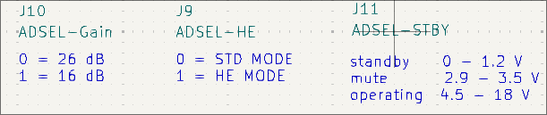
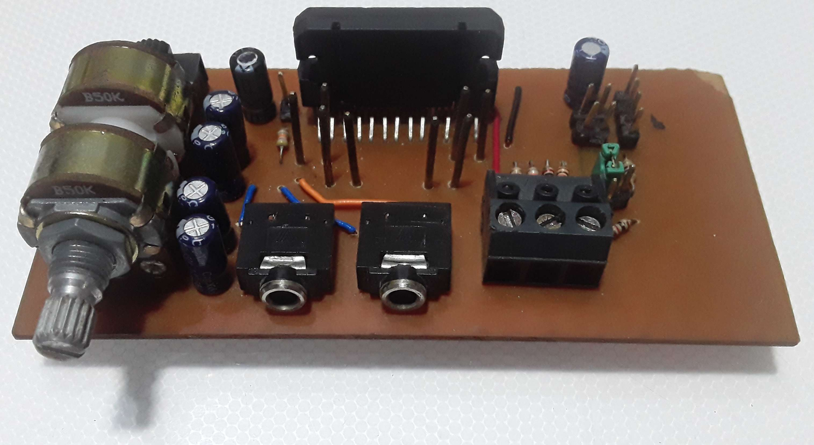

# TDA75610 Development Board (Placa de desarrollo)

El objetivo es el desarrollo de una PCB que sirva para utilizar y depurar el integrado TDA75610LV (montaje horizontal), y que se pueda fabricar en una placa de una sola cara.

[Repo](https://github.com/jackestar/TDA75610)

## Requisitos

* PCB de 1 cara
* Alimentación externa (Vcc-GND)
* Alimentación integrada para control con microcontrolador (+5 V)
* Control por pines y por I2C

## Alimentación

Según los datos del datasheet del TDA75610, el circuito puede operar de 6.5 V a 18 V (16 V para $R_L=2\ \Omega$).

Para la entrada se utiliza un conector Molex Fit Jr 2x2; además, se colocó protección contra polaridad inversa mediante un diodo con su respectivo filtrado por capacitores. Para la alimentación del microcontrolador se utilizó un regulador LDO AZ1117-ADJ (un AZ1117-5.0 puede simplificar el circuito; se usó la versión ADJ por disponibilidad). Este puede suministrar 1 A para una tensión de entrada de 15 V en su configuración típica. Como se esperan tensiones de hasta 18 V estando este valor por debajo del máximo absoluto de 20 V, se coloca una resistencia $R1$ de $5\ \Omega$ a la entrada para reducir la tensión ante cargas de corriente elevadas. El valor de $R2$ y $R3$ se estima con la tensión mínima de alimentación del TDA menos la tensión de *dropout* del regulador y la corriente máxima.

El regulador se ajusta a ~5 V:

$$
V_{Out}=V{Ref}\cdot(1+R_2/R_1)+I_{Adj}\cdot R_2
$$

Con $R_1=330\ \Omega$, $R_2=1\text{ k}\Omega$, $V_{Ref}=1.25\text{ V}$ e $I_{Adj}=120\ \mu\text{A}$ (despreciable), se obtiene una tensión en el peor de los casos de $5.1578\text{ V}$. Con este valor se calculó $R_{1_{max}}$ (la caída de tensión mínima que puede generar la resistencia):

$$
\frac{V_{TDA_{min}}-V_{Ref_{max}}}{I_{max}}=5.23\approx 5\ \Omega
$$

Para los capacitores se utilizaron modelos de tantalio, tal como recomienda el datasheet.

## Entrada de audio

El TDA75610 posee cuatro canales, por lo que se utilizaron dos puertos jack de entrada que pueden puentearse entre sí para seleccionar entre 2 y 4 canales. Para ajustar el volumen se utilizaron 4 potenciómetros con eje común.

## Control

El TDA permite el control a través de I2C y mediante una serie de pines. Para seleccionar en qué modo se realiza el control se utilizó un *dip-switch* SMD. Al cerrar el interruptor SW2 4-5 se habilita el modo I2C, tomando por defecto la dirección 1101100x; para otras direcciones se debe cambiar el valor de R7 acorde al datasheet del TDA. Para las resistencias de *pull-up* I2C se debe cerrar el interruptor SW2 1-8 y 2-7, y dejar J10 y J9 estrictamente abiertos. Si el control I2C está desactivado (SW2 4-5 abierto), el control se realiza a través de los pines J10, J9 y J11 —cerrando SW2 1-8, 2-7 y 3-6—, controlando ganancia, modo de alta eficiencia (*High Efficiency*) y Standby-Mute-Operación, respectivamente.

La salida para el *Clip detector* es de colector abierto, por lo que debe tener una resistencia de Pull-Up.

## Esquemático

[Esquemático](https://drive.google.com/file/d/1zOZ_QLpb7rlT-NX607TR__lV9A5XwjoH/view)

## Modelo 3D

<model-player
  src="/models/TDA75610LV.glb"
  poster="/models/TDA75610.png"
  alt="TDA75610 Development Board">
</model-player>

Revisión de 2 caras

:::note
No utiliza jumpers y las vías son solo para reforzar GND.
:::

<model-player
  src="/models/TDA75610LV-v2.glb"
  poster="/models/TDA75610LV-v2.png"
  alt="TDA75610 Development Board">
</model-player>

## Resultado

